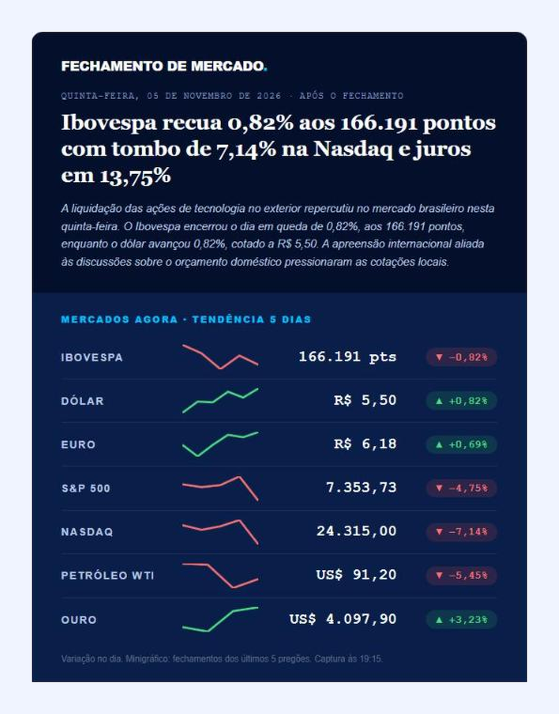
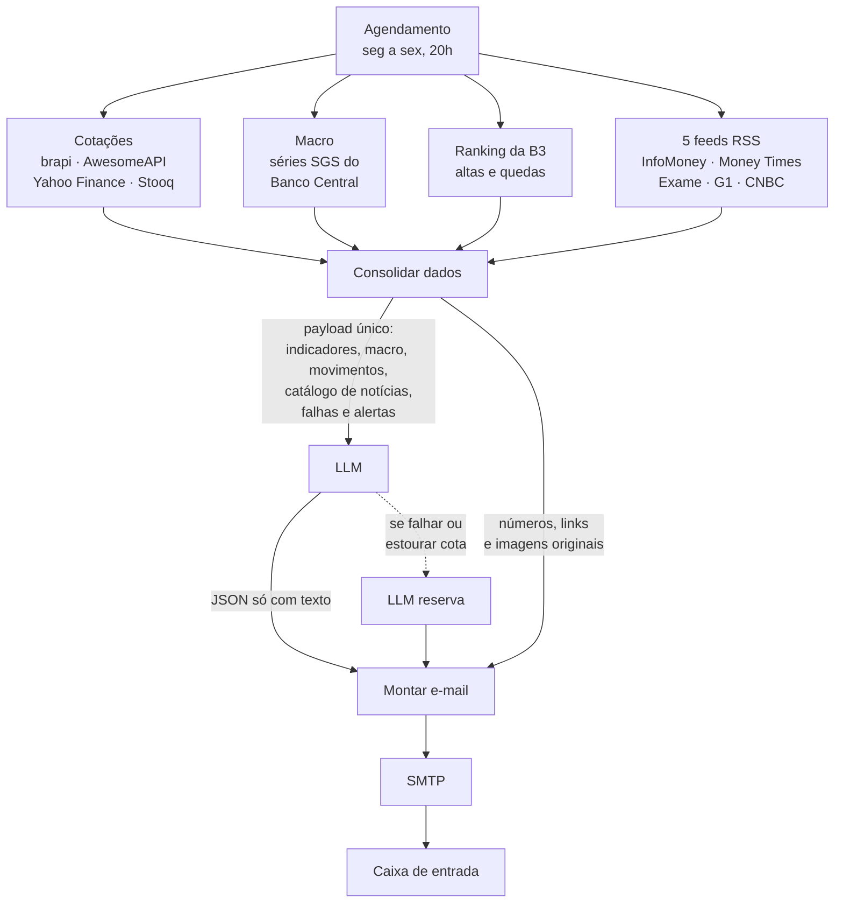

# Fechamento de Mercado

Todo dia útil às 20h, este projeto coleta dados de doze fontes públicas, consolida tudo num payload só, pede a um modelo de linguagem que escreva a análise e manda por e-mail o fechamento do mercado financeiro.

Roda em n8n self-hosted. Usa apenas API gratuita.



---

## Índice

- [O que chega no e-mail](#o-que-chega-no-e-mail)
- [Ver o resultado sem instalar nada](#ver-o-resultado-sem-instalar-nada)
- [Instalação passo a passo](#instalação-passo-a-passo)
- [Deixar rodando sozinho](#deixar-rodando-sozinho)
- [Como funciona por dentro](#como-funciona-por-dentro)
- [Decisões técnicas e bugs que custaram caro](#decisões-técnicas-e-bugs-que-custaram-caro)
- [Problemas comuns](#problemas-comuns)
- [Limitações e próximos passos](#limitações-e-próximos-passos)

---

## O que chega no e-mail

| Bloco | Conteúdo |
|---|---|
| Manchete e resumo | Título do dia e um parágrafo que resume a edição inteira |
| Painel de mercados | Ibovespa, dólar, euro, S&P 500, Nasdaq, petróleo WTI e ouro, com variação do dia e minigráfico de 5 pregões |
| Macro | Selic e IPCA, com mês de referência, direto das séries do Banco Central |
| Movimentos da B3 | Maiores altas e quedas, com código, nome e logotipo da empresa |
| Gráfico do dia | Barras comparando a variação de todos os indicadores |
| Análise | Brasil, EUA e mundo, implicação estratégica e o vetor a monitorar |
| Entenda | O mecanismo menos óbvio do dia, explicado para quem não é do mercado |
| Notícias | Cinco manchetes de portais diferentes, com imagem, link e selo da fonte |
| Rodapé | Fonte de cada número, horário da captura e o que falhou na execução |

---

## Ver o resultado sem instalar nada

Abra [`docs/preview-email.html`](docs/preview-email.html) no navegador. É o layout real, com números de exemplo. Nenhuma conta, chave ou instalação.

---

## Instalação passo a passo

### 1. Instalar o Node.js e o n8n

Baixe o [Node.js](https://nodejs.org) (versão 18 ou superior) e instale.

Depois abra o **Prompt de Comando** (no Windows, não use o PowerShell: ele bloqueia scripts do npm por padrão) e rode:

```bash
npm install -g n8n
```

### 2. Criar as contas

Três cadastros, todos com camada gratuita:

| Serviço | Para quê | Onde |
|---|---|---|
| **brapi** | Ibovespa e ranking de ações da B3 | [brapi.dev/dashboard](https://brapi.dev/dashboard) |
| **Um provedor de LLM** | Escrever o texto | [Gemini](https://aistudio.google.com/apikey), [Groq](https://console.groq.com/keys) ou [Grok](https://console.x.ai) |
| **Senha de app do Gmail** | Enviar o e-mail por SMTP | [myaccount.google.com/apppasswords](https://myaccount.google.com/apppasswords) |

A senha de app não é a senha da sua conta: é um código de 16 letras que o Google gera só para isso e que você pode revogar quando quiser. Ela exige verificação em duas etapas ativa.

As demais fontes (câmbio, Banco Central, Yahoo Finance, Stooq e os feeds de notícia) não pedem cadastro.

### 3. Baixar e configurar

```bash
git clone https://github.com/victorborges2/Fechamento-mercado-n8n_ia.git
cd Fechamento-mercado-n8n_ia
```

Copie o arquivo de configuração de exemplo:

```bash
copy build\config.exemplo.js build\config.local.js
```

Abra `build/config.local.js` num editor de texto e preencha:

```js
module.exports = {
  para: 'quem-recebe@exemplo.com',      // destinatário
  de: 'sua-conta@gmail.com',            // a mesma da senha de app
  cron: '0 20 * * 1-5',                 // 20h, de segunda a sexta
  provedor: 'gemini',                   // gemini, groq ou grok
  modelo: 'gemini-3.5-flash',
  reserva: {                            // entra se o principal falhar
    provedor: 'groq',
    modelo: 'openai/gpt-oss-120b'
  }
};
```

Esse arquivo fica fora do controle de versão. Nenhuma chave de API vai nele: as chaves são coladas no n8n, que as guarda criptografadas.

### 4. Gerar o workflow

Dê dois cliques em **`build/gerar.cmd`** (ou rode `node make.js` dentro da pasta `build`).

O gerador valida a sintaxe antes de escrever qualquer coisa. Se houver erro, ele aborta sem gerar nada. Saem dois arquivos:

- `workflow/fechamento-mercado.local.json` — com os seus dados, é o que você importa
- `docs/preview-email.html` — preview do e-mail para conferir o layout

Se preferir não gerar nada, importe direto o [`workflow/fechamento-mercado.json`](workflow/fechamento-mercado.json) e ajuste os e-mails no nó de envio.

### 5. Subir o n8n

No Windows, dê dois cliques em **`scripts/start-n8n.cmd`**. Ele fixa o fuso em `America/Sao_Paulo` e desliga a telemetria que polui o log.

Em outros sistemas, `n8n start`.

Abra `http://localhost:5678`.

### 6. Importar

Menu **⋯** no topo → **Import from File** → selecione o JSON gerado.

> **Atenção:** se você já tem uma versão anterior aberta, limpe o canvas antes com `Ctrl+A` e `Delete`. O n8n **acrescenta** os nós ao importar em vez de substituir, e duas cópias no mesmo canvas quebram as referências entre nós de forma silenciosa.

### 7. Colar as credenciais

| Nó | O que preencher |
|---|---|
| `Ibovespa (brapi)`, `Ranking B3 altas`, `Ranking B3 baixas` | troque `SEU_TOKEN_BRAPI` na URL pelo seu token |
| `Análise do dia (LLM)` | Gemini: header `x-goog-api-key`. Groq ou Grok: header `Authorization` com o valor `Bearer sua-chave` |
| `Análise do dia (reserva)` | a chave do segundo provedor, no mesmo formato |
| `Enviar e-mail` | credencial SMTP: servidor `smtp.gmail.com`, porta `465`, SSL ligado, usuário é o seu Gmail e senha é a senha de app |

No header `Authorization`, mantenha a palavra `Bearer` e o espaço antes da chave. Apagar isso é a causa mais comum de erro 401.

### 8. Testar

Clique em **Execute workflow**, o botão na parte de baixo do canvas.

> Não use o **Execute step** que aparece dentro de um nó aberto. Ele roda só aquele nó reaproveitando dados antigos, e o e-mail sai com buracos.

Em cerca de 30 segundos o e-mail chega. Confira o rodapé: se aparecer alguma linha vermelha ou amarela, ela diz exatamente qual fonte falhou e por quê.

---

## Deixar rodando sozinho

O e-mail é um **fechamento**, então precisa sair depois que tudo fechou.

| Evento | Horário de Brasília |
|---|---|
| Pregão da B3 encerra | entre 16h55 e 18h, varia com o horário de verão americano |
| After-market da B3 | até cerca de 18h |
| Nova York fecha | 18h ou 19h, também depende do horário de verão |
| Portais publicam o fechamento | ao longo da hora seguinte |

Por isso o padrão é **20h**. Rodar antes traz cotação parcial e notícia pela metade.

Três formas de manter o envio automático:

**1. Agendamento do próprio n8n.** Ative o workflow e deixe o n8n rodando. Simples, mas se o computador estiver desligado às 20h aquele dia não sai: o n8n não recupera execução perdida.

**2. Agendador do Windows.** Dê dois cliques em `scripts/agendar-fechamento.cmd`. Ele pergunta o ID do workflow (está no endereço quando você abre o workflow no n8n) e o horário, e cria uma tarefa que chama `n8n execute` direto.

A tarefa usa `StartWhenAvailable`: **se o PC estiver desligado às 20h, ela roda assim que você ligar**. Funciona na bateria, acorda a máquina suspensa e tenta de novo duas vezes em caso de falha.

Usando essa opção, deixe o workflow **desativado** no n8n, senão o e-mail chega duplicado. Para testar sem esperar:

```bash
schtasks /run /tn "Fechamento de Mercado"
```

**3. n8n Cloud.** Roda na nuvem, sem depender do seu computador. Importe o mesmo JSON e ative. Confira o fuso em **Settings → Timezone**, precisa ser `America/Sao_Paulo`. É a opção paga; as duas anteriores são gratuitas.

---

## Como funciona por dentro



O ponto central: **o modelo de linguagem não gera HTML e não repete número.** Ele recebe os dados prontos e devolve apenas texto, em JSON. Layout, valores e links são montados em código a partir da fonte original.

Para as notícias vale a mesma regra. O modelo escolhe quais destacar informando o **índice** do item no catálogo, e o programa recupera título, link, imagem e selo da fonte. Ele não tem como inventar uma URL.

### Stack

| Tecnologia | Papel |
|---|---|
| n8n self-hosted | Orquestração, agendamento e tratamento de erro por nó |
| Node.js | Dois nós de código: consolidação dos dados e montagem do HTML |
| Gemini / Groq / Grok | Redação do texto, intercambiáveis por configuração, com provedor reserva |
| SMTP com senha de app | Envio |
| QuickChart | Minigráficos e gráfico de barras, renderizados como imagem porque e-mail não executa JavaScript |
| HTML com CSS inline | Única forma de o layout sair igual no Gmail e no Outlook |

### Fontes de dados

| Fonte | Para quê | Chave |
|---|---|---|
| [brapi](https://brapi.dev) | Ibovespa, ranking, nome e logotipo das empresas | gratuita |
| [AwesomeAPI](https://docs.awesomeapi.com.br/api-de-moedas) | Dólar e euro, cotação e histórico | não precisa |
| [SGS do Banco Central](https://dadosabertos.bcb.gov.br) | Selic e IPCA | não precisa |
| Yahoo Finance | Índices, commodities e séries de 5 pregões | não precisa |
| [Stooq](https://stooq.com) | Reserva automática do Yahoo | não precisa |
| RSS | InfoMoney, Money Times, Exame, G1 Economia e CNBC | não precisa |

### Estrutura do repositório

```
build/        código-fonte: coleta, montagem do HTML e gerador do workflow
workflow/     JSON pronto para importar no n8n
scripts/      inicialização do n8n e criação da tarefa agendada no Windows
docs/         preview do e-mail
assets/       imagem do README
```

**O JSON do workflow é gerado, nunca editado à mão.** A fonte da verdade é a pasta `build/`. Detalhes da cadeia de nós, contrato de dados e regras que não podem ser quebradas estão em [`ARQUITETURA.md`](ARQUITETURA.md).

---

## Decisões técnicas e bugs que custaram caro

### A variação que não era do dia

**Sintoma.** Uma auditoria externa apontou que o petróleo aparecia com queda de 5,45% num dia em que havia subido 3,50%, e que Nasdaq e S&P traziam percentuais maiores que os oficiais. Pior: o minigráfico ao lado contava outra história.

**Causa raiz.** O cálculo usava `chartPreviousClose` da resposta do Yahoo Finance. Esse campo não é o fechamento do pregão anterior, é o fechamento **anterior ao início da janela pedida**. Como a requisição pede `range=5d`, o que estava sendo publicado como "variação no dia" era a variação de cinco pregões.

**Solução.** A variação passou a ser calculada a partir da própria série que desenha o minigráfico: último fechamento contra o penúltimo. Número e gráfico contam a mesma história por construção.

**A trava que faltava.** Uma função `conferir()` compara o percentual exibido com o implícito na série. Divergência acima de 0,3 ponto percentual é registrada e impressa em amarelo no rodapé:

```
Inconsistência detectada entre percentual e série:
Euro: chip diz 1.40% mas a série indica 0.12%
```

Esse alerta apareceu na primeira execução real depois de instalado, e expôs outro problema: a cotação vinha do endpoint `last` (spot no instante da captura) enquanto a série vinha do `daily`, que ainda não tinha registrado o dia corrente. A correção foi anexar a cotação atual ao fim da série.

**O que eu faria diferente.** Teria escrito essa validação antes do primeiro envio. Dado que vem de duas fontes distintas e nunca é confrontado é dado em que não se pode confiar.

### A falha que não aparecia

**Sintoma.** Selic e IPCA simplesmente não apareciam no e-mail. Nenhum nó ficava vermelho, nenhum erro no log, e o e-mail chegava normalmente todo dia.

**Causa raiz.** A API do Banco Central devolve um array JSON. O n8n não entrega isso como um array dentro de `.json`: ele **quebra cada elemento num item separado**. O código fazia `$('Selic (BCB)').first().json[0].valor`, esperando um array e recebendo um objeto. O acesso retornava `undefined` e um `try/catch` engolia a exceção.

**Como descobri.** Instrumentando a própria saída. Um array `falhas` registra toda fonte que não respondeu, com o motivo, e imprime a lista no rodapé do e-mail. No dia seguinte o próprio e-mail entregou o culpado.

```js
// n8n entrega array JSON como ITENS separados, não como array dentro de .json
const itens = (node) => {
  const arr = $(node).all().map(i => i.json);
  if (arr.length === 1 && Array.isArray(arr[0])) return arr[0];
  return arr;
};

try {
  const s = serieBCB('Selic (BCB)');
  macro.push({ nome: 'Selic (meta)', valor: s.valor + '% a.a.' });
} catch (e) { falhou('Selic (BCB)', e); }
```

### Outras decisões que vieram de problema real

**O modelo escolhe notícia por índice.** A primeira versão deixava o modelo devolver título e link. Ele inventava URL. Agora recebe um catálogo numerado e responde com o índice.

**Catálogo intercalado por portal.** O catálogo ia agrupado por fonte e o modelo pegava sempre os primeiros: as cinco notícias saíam todas do mesmo site. Passou a ser intercalado em rodízio, com exigência de no mínimo três portais distintos.

**Campo vazio quando não há dado.** Num dia em que as fontes dos EUA caíram, o modelo escreveu uma análise inteira sobre "postura defensiva dos mercados internacionais" sem ter recebido um número sequer. O prompt agora manda devolver string vazia e o código omite a seção.

**Altas rotuladas como quedas.** O endpoint de ranking da brapi ordena numa direção só. Pegar as últimas da lista de altas devolvia papéis que subiram pouco, apresentados como as maiores quedas. Hoje são dois nós, um ordenando para cada lado, com filtro de liquidez mínima que descarta fracionários e BDRs.

**SMTP no lugar de OAuth.** O nó Gmail com OAuth parava de funcionar a cada sete dias: com o app em modo de teste no Google Cloud o refresh token expira nesse prazo, e publicar exigiria domínio próprio e política de privacidade.

**Validação de sintaxe no build.** Uma string de prompt quebrada ao meio passou despercebida e só estourou na execução. O gerador agora valida a sintaxe dos nós de código e aborta sem escrever nada.

---

## Problemas comuns

| Sintoma | Causa provável |
|---|---|
| Rodapé diz `Node 'X' hasn't been executed` | Você usou **Execute step** em vez de **Execute workflow**, ou há duas cópias do workflow no mesmo canvas |
| E-mail chega vazio | O campo de mensagem aponta para o formato de resposta de outro provedor de LLM |
| Erro 401 no nó do LLM | No Groq e no Grok, o header `Authorization` precisa do prefixo `Bearer ` antes da chave |
| Erro 429 ou 503 no LLM | Cota diária esgotada. Teste com a resposta do nó fixada (ícone de pin) para não consumir chamadas à toa |
| `npm` não roda no PowerShell | Política de execução de scripts. Use o Prompt de Comando |
| Minigráficos não aparecem | O cliente de e-mail está bloqueando imagem externa |
| Workflow some ao reiniciar o PC | O n8n precisa ser iniciado de novo. Use `scripts/start-n8n.cmd` ou a tarefa agendada |

---

## Limitações e próximos passos

- Rodando local com o agendamento do n8n, o e-mail só sai se o computador estiver ligado. A tarefa do Windows contorna isso.
- Todo nível gratuito de LLM tem cota diária. Em produção é uma chamada por dia, bem abaixo do limite, mas testar repetidamente esgota.
- O plano gratuito da brapi não devolve série histórica, então os fechamentos do Ibovespa vêm do Yahoo.
- O câmbio do painel é cotação spot no horário da captura, não o fechamento comercial apurado pelo Banco Central. Os dois medem coisas diferentes e isso está declarado no rodapé do e-mail.

Planejado, nesta ordem:

1. Gravar cada execução em banco, para ter série histórica própria casada com o noticiário do dia
2. Usar esse histórico no texto: "menor nível em três semanas", "quarta queda seguida"
3. Watchlist com fundamentos por ativo
4. Separar a análise em agentes especializados, com visão de alta e de baixa confrontadas

---

## Aviso

Projeto pessoal, de uso informativo. Não constitui recomendação de investimento, não executa ordens e não se conecta a corretora. Rentabilidade passada não garante resultados futuros.

## Autor

Victor Borges — [LinkedIn](https://www.linkedin.com/in/victor-borges22/)

## Licença

MIT
