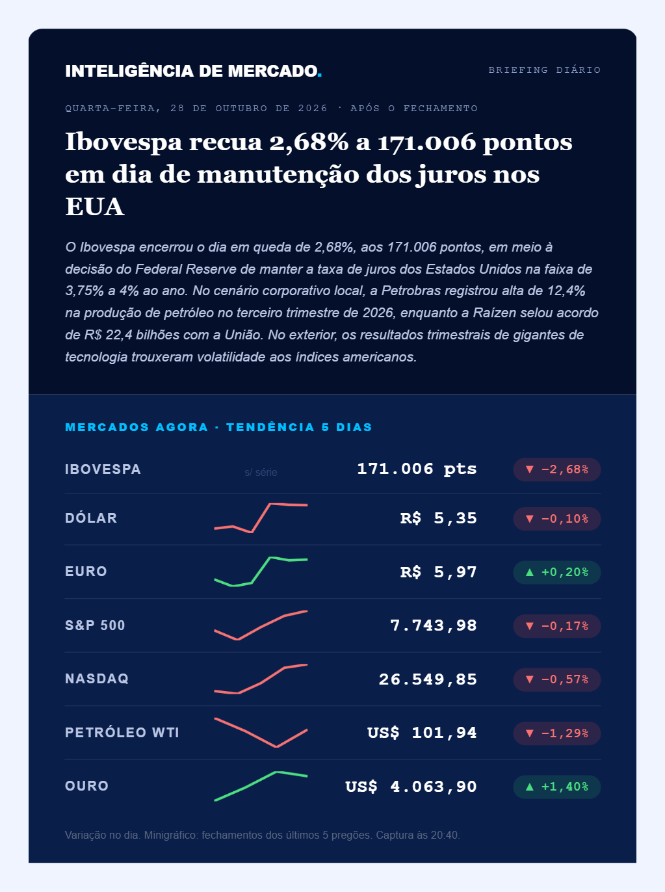
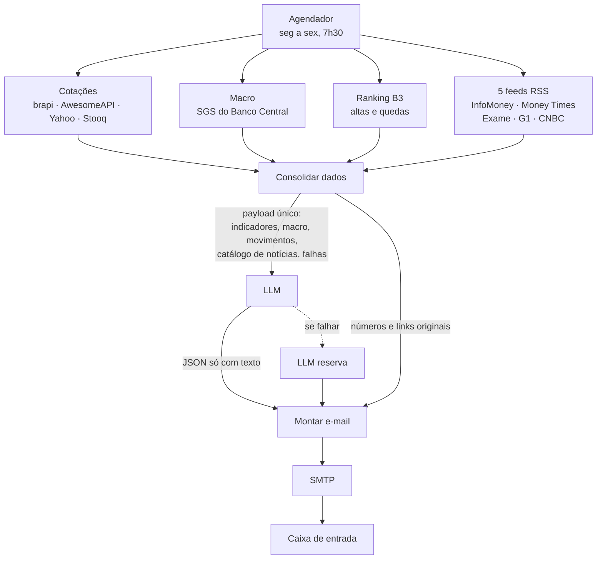

# Briefing Diário de Mercado

Automação que coleta dados de doze fontes públicas, consolida tudo num payload único e envia por e-mail um briefing do mercado financeiro todo dia útil. Feito para quem quer acompanhar mercado sem abrir cinco abas antes das sete da manhã.

Roda em n8n self-hosted. Usa só API gratuita.



---

## O problema

Toda manhã eu abria InfoMoney, Investing, o site do Banco Central e mais duas abas para ver Ibovespa, dólar, Selic e o que tinha acontecido na noite anterior lá fora.

Levava uns quinze minutos e eu sempre esquecia alguma coisa. Pior: os números ficavam soltos das notícias. Eu via o dólar caindo e a manchete do Copom em lugares diferentes, sem ninguém amarrar uma coisa na outra.

A parte difícil nunca foi buscar cotação. Foi decidir **quais** dados importam, consolidar todos num formato só e cruzar com a notícia certa antes de qualquer modelo de linguagem encostar no assunto.

---

## Como funciona



O ponto central: **o modelo de linguagem não gera HTML e não repete número.** Ele recebe os dados já prontos e devolve apenas texto, em JSON. Layout, valores e links são montados em código a partir da fonte original.

Para as notícias vale a mesma regra. O modelo escolhe quais destacar informando o **índice** do item no catálogo, e o programa recupera título, link, imagem e selo da fonte do feed. Ele não tem como inventar uma URL.

---

## Stack

| Tecnologia | Papel no projeto |
|---|---|
| n8n (self-hosted) | Orquestração, agendamento por cron e tratamento de erro por nó |
| Node.js | Dois nós de código: consolidação dos dados e montagem do HTML |
| Gemini / Groq / Grok | Redação do texto. Intercambiáveis por configuração, com provedor de reserva |
| SMTP com senha de app | Envio do e-mail |
| QuickChart | Minigráficos de tendência, renderizados como imagem porque e-mail não executa JavaScript |
| HTML com CSS inline | Única forma de o layout sair igual no Gmail e no Outlook |

### Fontes de dados

| Fonte | Para quê | Chave |
|---|---|---|
| [brapi](https://brapi.dev) | Ibovespa e ranking de ações da B3 | gratuita |
| [AwesomeAPI](https://docs.awesomeapi.com.br/api-de-moedas) | Dólar e euro, cotação e histórico | não precisa |
| [SGS do Banco Central](https://dadosabertos.bcb.gov.br) | Selic e IPCA | não precisa |
| Yahoo Finance | Índices, commodities e série de 5 pregões | não precisa |
| [Stooq](https://stooq.com) | Reserva automática do Yahoo | não precisa |
| RSS | InfoMoney, Money Times, Exame, G1 Economia e CNBC | não precisa |

---

## Como rodar

### Pré-requisitos

- [Node.js](https://nodejs.org) 18 ou superior
- n8n: `npm install -g n8n`

### Ver o resultado sem configurar nada

O gerador roda com dados de exemplo e produz o preview do e-mail. Não precisa de chave, conta ou acesso a sistema nenhum.

```bash
git clone https://github.com/victorborges2/fechamento-mercado-n8n.git
cd fechamento-mercado-n8n/build
node make.js
```

Abra `docs/preview-email.html` no navegador. É o layout real, com números de exemplo.

### Rodar de verdade

```bash
cp build/config.exemplo.js build/config.local.js
# edite com seu e-mail, horário, provedor e modelo
cd build && node make.js
```

O build valida a sintaxe dos nós de código antes de gerar. Se houver erro, aborta sem escrever nada.

Saem dois arquivos: `workflow/briefing-mercado.local.json`, com os seus dados, e `docs/preview-email.html`.

Suba o n8n e importe:

```bash
n8n start
# localhost:5678 → Workflows → Import from File
```

No Windows, use `scripts/start-n8n.cmd`, que fixa o fuso e desliga a telemetria que polui o log.

### Contas necessárias

| Serviço | Para quê | Obrigatória |
|---|---|---|
| [brapi](https://brapi.dev/dashboard) | Cotação do Ibovespa e ranking da B3 | sim |
| [Gemini](https://aistudio.google.com/apikey), [Groq](https://console.groq.com/keys) ou [Grok](https://console.x.ai) | Redação do texto | sim, uma delas |
| Segundo provedor de LLM | Reserva quando o principal falha | opcional |
| [Senha de app do Gmail](https://myaccount.google.com/apppasswords) | Envio por SMTP | sim |

---

## Configuração

As chaves de API **não ficam em arquivo nenhum do repositório**. Elas vão direto nos nós do n8n, que guarda credencial criptografada. O arquivo de configuração só define o que não é segredo:

| Campo | Para que serve | Obrigatório |
|---|---|---|
| `para` | E-mail que recebe o briefing | sim |
| `de` | Conta que envia, a mesma da senha de app | sim |
| `cron` | Horário do disparo. Padrão `30 7 * * 1-5` | sim |
| `provedor` | `gemini`, `groq` ou `grok` | sim |
| `modelo` | Modelo do provedor escolhido | sim |
| `reserva` | Provedor e modelo de reserva, ou `null` | não |

`config.local.js` está no `.gitignore`. O repositório versiona só o `config.exemplo.js`.

No n8n, preencha:

| Nó | O que colar |
|---|---|
| `Ibovespa (brapi)` e os dois `Ranking B3` | seu token no lugar de `SEU_TOKEN_BRAPI` na URL |
| `Análise do dia (LLM)` | Gemini: header `x-goog-api-key`. Groq e Grok: `Authorization: Bearer sua-chave` |
| `Análise do dia (reserva)` | a chave do segundo provedor |
| `Enviar e-mail` | credencial SMTP: `smtp.gmail.com`, porta 465, SSL |

---

## Decisões técnicas e obstáculos

### A falha que não aparecia

**Sintoma.** Selic e IPCA simplesmente não apareciam no e-mail. Nenhum nó ficava vermelho, nenhum erro no log, e o briefing chegava normalmente todo dia. Passou despercebido por semanas.

**Causa raiz.** A API SGS do Banco Central devolve um array JSON. O n8n não entrega isso como um array dentro de `.json`: ele **quebra cada elemento num item separado**. Meu código fazia `$('Selic (BCB)').first().json[0].valor`, esperando um array, e recebia um objeto. O acesso retornava `undefined`, o `try/catch` em volta engolia a exceção, e o campo era omitido em silêncio.

**Como descobri.** Instrumentando a própria saída. Criei um array `falhas` que registra toda fonte que não respondeu e imprimo a lista no rodapé do e-mail. No dia seguinte o briefing me entregou o culpado.

```js
// n8n entrega array JSON como ITENS separados, não como array dentro de .json
const itens = (node) => {
  const arr = $(node).all().map(i => i.json);
  if (arr.length === 1 && Array.isArray(arr[0])) return arr[0];
  return arr;
};

try {
  const s = serieBCB('Selic (BCB)');
  macro.push({ nome: 'Selic (meta)', valor: s.valor + '% a.a.' });
} catch (e) { falhou('Selic (BCB)', e); }
```

**O que eu faria diferente.** Teria começado pelo registro de falha, não pelo primeiro indicador. Catch vazio em pipeline de integração é dívida que vence sem avisar. Hoje toda fonte que cai aparece no rodapé **com o motivo**, e o build valida a sintaxe dos nós de código antes de gerar o workflow.

### Outras decisões que vieram de problema real

**O modelo escolhe notícia por índice.** Primeira versão deixava o modelo devolver título e link. Ele inventava URL. Agora recebe um catálogo numerado e responde com o índice; o programa recupera link, imagem e fonte do feed.

**Catálogo intercalado por portal.** O catálogo ia agrupado por fonte, e o modelo pegava sempre os primeiros: as cinco notícias saíam todas do mesmo site. Passei a intercalar em rodízio e a exigir no mínimo três portais distintos.

**Campo vazio quando não há dado.** Num dia em que as fontes dos EUA caíram, o modelo escreveu uma análise inteira sobre "postura defensiva dos mercados internacionais" sem ter recebido um número sequer. O prompt agora manda devolver string vazia, e o código omite a seção.

**SMTP no lugar de OAuth.** O nó Gmail com OAuth parava de funcionar a cada sete dias: com o app em modo de teste no Google Cloud, o refresh token expira nesse prazo, e publicar exigiria domínio próprio e política de privacidade. Troquei por SMTP com senha de app, que não expira.

**Fallback em duas camadas.** Yahoo Finance recusa requisição sem aviso de tempos em tempos, então o Stooq assume. O nó do LLM tem saída de erro ligada a um segundo provedor, porque nível gratuito estoura cota.

---

## Exemplo de saída

O e-mail chega assim (números fictícios):

```
INTELIGÊNCIA DE MERCADO
quarta-feira, 28 de outubro de 2026 · após o fechamento

Ibovespa recua 2,68% em dia de manutenção dos juros nos EUA

MERCADOS AGORA · TENDÊNCIA 5 DIAS
Ibovespa      [gráfico]   171.006 pts    ▼ −2,68%
Dólar         [gráfico]   R$ 5,35        ▼ −0,10%
S&P 500       [gráfico]   7.743,98       ▼ −0,17%
Ouro          [gráfico]   US$ 4.063,90   ▲ +1,40%

Selic (meta) 13,75% a.a.      IPCA 0,82% (último mês fechado)

01 // BRASIL          02 // EUA E MUNDO
03 // IMPLICAÇÃO ESTRATÉGICA  + vetor a monitorar
04 // O QUE IMPORTA HOJE      5 notícias com imagem e link

Fontes indisponíveis nesta execução: nenhuma
```

---

## Limitações conhecidas

- Rodando local, o briefing só sai se o computador estiver ligado no horário. O n8n não recupera execução perdida.
- Todo nível gratuito de LLM tem cota diária. Em produção é uma chamada por dia, mas testar repetidamente esgota. Fixe a resposta do nó (pin) enquanto ajusta o layout.
- O plano gratuito da brapi não devolve série histórica, então os fechamentos do Ibovespa vêm do Yahoo.
- Alguns clientes de e-mail bloqueiam imagem externa por padrão, o que afeta minigráficos e fotos das notícias.

## Próximos passos

1. Gravar cada execução em banco, para ter série histórica própria casada com o noticiário do dia
2. Usar esse histórico no texto: "menor nível em três semanas", "quarta queda seguida"
3. Watchlist com fundamentos por ativo
4. Separar a análise em agentes especializados, com visão de alta e de baixa confrontadas

---

## Aviso

Projeto pessoal, de uso informativo. Não constitui recomendação de investimento, não executa ordens e não se conecta a corretora.

## Autor

Victor Borges — [LinkedIn](https://www.linkedin.com/in/victor-borges22/)

## Licença

MIT
